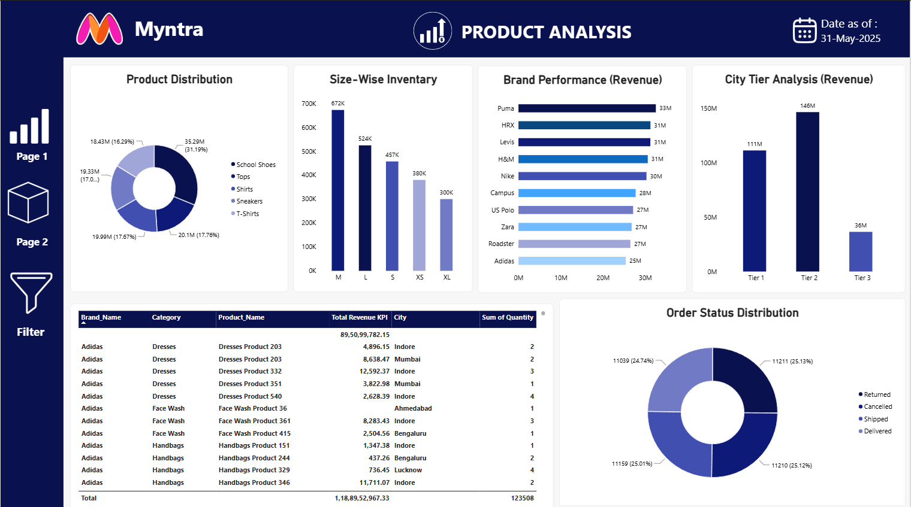

<div align="center">

# -- ! Myntra Sales & Product Analysis Dashboard ! --
### *Interactive Power BI Dashboard for E-Commerce Sales, Product & City-Tier Insights*

[](https://powerbi.microsoft.com/)
[](https://learn.microsoft.com/en-us/dax/)
[](https://powerbi.microsoft.com/)
[](https://powerbi.microsoft.com/)


 Video Link-https://drive.google.com/file/d/1osfUXgXUv2ypsVMCc5_7rom48Bi0y2b1/view?usp=sharing
<br/>

> *"Data tells a story — a dashboard makes everyone listen."*

</div>

---

## 📋 Table of Contents

- [📌 Overview](#-overview)
- [🎯 Problem Statement](#-problem-statement)
- [✨ Key Features](#-key-features)
- [🏗️ Project Structure](#️-project-structure)
- [🔄 Project Workflow](#-project-workflow)
- [📊 Page 1 — Sales Overview](#-page-1--sales-overview)
- [🛍️ Page 2 — Product Analysis](#️-page-2--product-analysis)
- [🛠️ Tech Stack](#️-tech-stack)
- [📈 Results & Insights](#-results--insights)
- [🏆 Advantages](#-advantages)
- [📄 License](#-license)
- [👤 Author](#-author)
- [🙏 Acknowledgements](#-acknowledgements)

---

## 📌 Overview

The **Myntra Sales & Product Analysis Dashboard** is an interactive **Power BI** report that turns raw e-commerce order data into clear, decision-ready visuals. It contains **two report pages** — *Sales Overview* and *Product Analysis* — with slicers for **Brand**, **Category** and **City Tier**, so any viewer can slice the data in one click.

This project is designed to:
- Track key business KPIs such as **Total Orders** and **Total Revenue**
- Compare **brands, categories and city tiers** on orders and revenue
- Monitor **size-wise inventory** and **order status** distribution
- Practice **data cleaning, data modeling, DAX measures** and **dashboard design** in Power BI

---

## 🎯 Problem Statement

> **Objective:** Build an interactive Power BI dashboard to analyze Myntra sales performance across brands, categories, products and city tiers.

You are building a reporting solution for a business team that wants to quickly understand *what is selling, where it is selling, and how orders are progressing*. The dashboard must answer these questions with filters and visuals rather than raw tables.

| 📂 Feature | 📄 Type | 🔍 Description |
|------------|---------|----------------|
| Total Orders KPI | Card + Trend | Total orders with trend line and comparison vs previous month |
| Total Revenue KPI | Card + Trend | Total revenue (in ₹ Cr) with trend line and comparison |
| Order By City Tier | Donut Chart | Share of orders across Tier 1, Tier 2 and Tier 3 cities |
| Orders By Category / Brand | Bar Charts | Top categories and brands by number of orders |
| Product Distribution | Donut Chart | Category-wise share of the product base |
| Size-Wise Inventory | Column Chart | Inventory units for sizes M, L, S, XS, XL |
| Brand / City Tier Revenue | Bar / Column | Revenue performance by brand and by city tier |
| Detail Table | Table | Brand, Category, Product, City, Revenue and Quantity |
| Order Status Distribution | Donut Chart | Returned, Cancelled, Shipped and Delivered orders |

The goal is to demonstrate **end-to-end Power BI skills** — from raw data to a polished, interactive report.

---

## ✨ Key Features

| Feature | Description |
|--------|-------------|
| 📑 **2-Page Report** | Sales Overview (Page 1) and Product Analysis (Page 2) with side navigation |
| 🎛️ **Smart Slicers** | Filter by Brand, Category and City Tier — all visuals update instantly |
| 📊 **KPI Cards with Trend** | Total Orders & Total Revenue with sparkline and month-over-month comparison |
| 🍩 **Donut Charts** | City Tier, Product Distribution and Order Status shares at a glance |
| 🏷️ **Brand Analysis** | Orders and revenue compared across 10 brands (Puma, Nike, HRX, Levis, H&M, etc.) |
| 📏 **Size-Wise Inventory** | Stock levels for M, L, S, XS and XL sizes |
| 🧾 **Drill-Down Table** | Product-level details with revenue, city and quantity totals |
| 🎨 **Consistent Theme** | Navy-blue Myntra-inspired colour palette with clean layout and icons |

---

## 🏗️ Project Structure

```
📦 Myntra-PowerBI-Dashboard/
│
├── 📊 Myntra_Dashboard.pbix      ← Power BI project file (add your .pbix here)
│
├── 📁 images/
│   ├── 🖼️ sales-overview.png      ← Page 1 output screenshot
│   └── 🖼️ product-analysis.png    ← Page 2 output screenshot
│
└── 📄 README.md                  ← Project documentation
```

---

## 🔄 Project Workflow

```
Raw Data (Orders, Products, Brands, Cities)
      │
      ▼
┌─────────────────────────────┐
│   Power Query               │  ← Clean, transform & shape data
└────────────┬────────────────┘
             │
             ▼
┌─────────────────────────────┐
│   Data Model                │  ← Relationships between tables
└────────────┬────────────────┘
             │
             ▼
┌─────────────────────────────┐
│   DAX Measures              │  ← Total Orders, Revenue KPI, Quantity
└────────────┬────────────────┘
             │
     ┌───────┴────────┐
     ▼                ▼
┌──────────────┐  ┌──────────────────┐
│   Page 1     │  │     Page 2       │
│ Sales        │  │ Product          │
│ Overview     │  │ Analysis         │
└──────┬───────┘  └────────┬─────────┘
       │                   │
       ▼                   ▼
┌─────────────────────────────┐
│  Slicers: Brand / Category  │
│  / City Tier                │
└────────────┬────────────────┘
             │
             ▼
   Insights & Business Decisions ✅
```

---

## 📊 Page 1 — Sales Overview

### 📝 1. What does this page show?

The **Sales Overview** page gives a high-level snapshot of business performance as of **31-May-2025**: how many orders were placed, how much revenue was generated, and which categories, brands and city tiers contribute the most.

---

### 🖼️ 2. Dashboard Output




---

### 🗺️ 3. Visuals — Overview

| Visual | Type | Insight |
|--------|------|---------|
| 🛒 **Total Orders** | KPI Card + Area Trend | **180K** orders |
| 💰 **Total Revenue** | KPI Card + Area Trend | **₹ 118.90 Cr** revenue |
| 🍩 **Order By City Tier** | Donut Chart | Tier 2 leads with ~50% of orders |
| 📊 **Orders By Category** | Column Chart | School Shoes is the top category (6.1K) |
| 📊 **Orders By Brand** | Bar Chart | Puma leads (5.4K), followed by Nike (5.2K) |
| 🎛️ **Slicers** | Brand · Category · City Tier | Interactive filtering of every visual |

---

### 🍩 4. Order By City Tier

| City Tier | Orders | Share |
|-----------|--------|-------|
| 🥇 Tier 2 | 89.95K | 49.97% |
| 🥈 Tier 1 | 67.43K | 37.46% |
| 🥉 Tier 3 | 22.62K | 12.57% |

---

### 🏆 5. Top Categories & Brands by Orders

| 🏷️ Top Categories | Orders | 🏢 Top Brands | Orders |
|-------------------|--------|---------------|--------|
| School Shoes | 6.1K | Puma | 5.4K |
| Tops | 3.4K | Nike | 5.2K |
| Shirts | 3.4K | US Polo | 4.6K |
| Sneakers | 3.3K | Zara | 4.5K |
| T-Shirts | 3.1K | Roadster | 4.5K |

---

## 🛍️ Page 2 — Product Analysis

### 🔍 6. What does this page show?

The **Product Analysis** page goes deeper into the product side of the business — category mix, size-wise stock, brand and city-tier revenue, product-level details and the status of every order.

---

### 🖼️ 7. Dashboard Output


---

### 🗺️ 8. Visuals — Overview

| Visual | Type | Insight |
|--------|------|---------|
| 🍩 **Product Distribution** | Donut Chart | School Shoes hold the largest share (31.19%) |
| 📏 **Size-Wise Inventory** | Column Chart | Size M has the highest inventory (672K) |
| 🏷️ **Brand Performance (Revenue)** | Bar Chart | Puma leads with 33M revenue |
| 🏙️ **City Tier Analysis (Revenue)** | Column Chart | Tier 2 generates the highest revenue (146M) |
| 🧾 **Detail Table** | Table | Brand, Category, Product, Revenue KPI, City, Quantity |
| 📦 **Order Status Distribution** | Donut Chart | Returned, Cancelled, Shipped, Delivered ≈ 25% each |

---

### 📏 9. Size-Wise Inventory

| Size | Inventory |
|------|-----------|
| M | 672K |
| L | 524K |
| S | 457K |
| XS | 380K |
| XL | 300K |

---

### 🏷️ 10. Brand Performance (Revenue)

| Brand | Revenue | Brand | Revenue |
|-------|---------|-------|---------|
| Puma | 33M | Campus | 28M |
| HRX | 31M | US Polo | 27M |
| Levis | 31M | Zara | 27M |
| H&M | 31M | Roadster | 27M |
| Nike | 30M | Adidas | 25M |

---

### 🏙️ 11. City Tier Revenue & Order Status

| 🏙️ City Tier | Revenue | 📦 Order Status | Orders (approx. share) |
|--------------|---------|-----------------|------------------------|
| Tier 1 | 111M | Delivered | ~25% |
| Tier 2 | 146M | Shipped | ~25% |
| Tier 3 | 36M | Cancelled | ~25% |
| — | — | Returned | ~25% |

> 🧮 **Grand Total (table):** Revenue ₹ 1,18,89,52,967.33 · Quantity **1,23,508**

---

## 🛠️ Tech Stack

| Tool | Version | Purpose |
|------|---------|---------|
| 📊 **Power BI Desktop** | Latest | Report building & visualization |
| 🔄 **Power Query** | Built-in | Data cleaning & transformation |
| 🧮 **DAX** | Built-in | Measures, KPIs and calculations |
| 🔗 **Data Modeling** | Built-in | Relationships between tables |
| 🎛️ **Slicers & Filters** | Built-in | Interactive filtering |
| 🎨 **Custom Theme** | Navy-blue palette | Consistent, branded look |

---

## 📈 Results & Insights

After analyzing the dashboard, the following insights are produced:

- ✅ **180K Total Orders** and **₹ 118.90 Cr Total Revenue** as of 31-May-2025
- 🏙️ **Tier 2 cities** contribute the most orders (~50%) and the highest revenue (146M)
- 👟 **School Shoes** is the best-selling category and holds ~31% of the product base
- 🏆 **Puma** leads in both orders (5.4K) and revenue (33M), followed by Nike
- 📏 **Size M** has the highest inventory (672K), while **XL** has the lowest (300K)
- 📦 Order status is almost evenly split, so **cancelled and returned orders** (~50% combined) deserve attention
- 📉 Trend lines drop at the end of the period, suggesting the latest month's data may be incomplete

---

## 🏆 Advantages

| Advantage | Detail |
|-----------|--------|
| 🎓 **Beginner Friendly** | Covers cleaning, modeling, DAX and visuals in one project |
| 🖱️ **Interactive** | Slicers let anyone explore data without technical skills |
| 📊 **Decision Ready** | KPIs and charts highlight top brands, categories and cities |
| 🔄 **Reusability** | Same structure can be reused for any e-commerce dataset |
| 🎨 **Clean Design** | Consistent colours, icons and layout improve readability |
| 🧪 **Extensible** | Easy to add pages — Customer Analysis, Returns Analysis, etc. |
| 📖 **Easy to Understand** | Two focused pages with clear titles and labels |
| ⚡ **Fast Insights** | Business questions answered in seconds, not hours |

---

## 📄 License

This project is licensed under the **MIT License** — see the [LICENSE](LICENSE) file for full details.

```
MIT License — Free to use, modify, and distribute with attribution.
```

---

## 👤 Author

<div align="center">

### Krinal Dholakiya

[](https://github.com/krinaldholakiya)
[](https://www.linkedin.com/in/krinaldholakiya-686533312/)

> *"Every chart starts with a single data point — just like every insight starts with a single question."*

**🎓 Role:** Data Analyst Enthusiast | Power BI Developer \
**📍 Location:** India\
**🛠️ Skills:** Power BI · DAX · Power Query · Data Modeling · Dashboard Design

</div>

---

## 🙏 Acknowledgements

Special thanks to the following resources and communities that made this project possible:

- 📚 [Power BI Official Docs](https://learn.microsoft.com/en-us/power-bi/) — Official Power BI documentation
- 🧮 [DAX Guide](https://dax.guide/) — Complete DAX function reference
- 🔄 [Power Query Docs](https://learn.microsoft.com/en-us/power-query/) — Data transformation guide
- 🎨 [Microsoft Power BI Community](https://community.fabric.microsoft.com/) — Questions and best practices
- 📖 [Kaggle Learn](https://www.kaggle.com/learn) — Data analysis courses
- 💬 [Stack Overflow Community](https://stackoverflow.com/) — Problem-solving support

---

<div align="center">

---

*Made with ❤️ — Last updated: 05 November, 2026*

</div>
